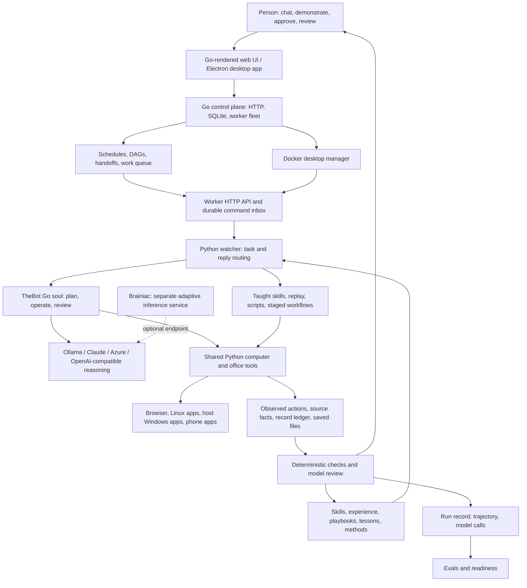

# Decurix: product and codebase understanding

A guide to what Decurix is and how its parts connect. Synced with the code on 2026-11-07. For a file-by-file inventory, see the generated [code map](../CODE_MAP.md) (`go run codemap_gen.go`, `internal/codemap`). Source and startup wiring take precedence when this guide disagrees.

## Product and vision

Decurix's stated promise is **“Teach once. Delegate forever.”** A person gives an AI worker its own computer, demonstrates a job, explains the rules and desired outcome, and delegates future instances. The worker should carry out the work, show what actually happened, ask when human judgment or authorization is needed, and retain what it learned.

The persistent unit of the product is a **worker**: an identity, desktop and applications, files, conversation, skills, experience, and access to a reasoning engine. The longer-term direction is a workforce that takes responsibility for business processes and cooperates across workers. The present implementation and regression scenarios put considerable emphasis on finance and back-office work: invoices, reconciliation, procurement, onboarding, spreadsheets, documents, business applications, portals, and email.

The clearest product priorities are **correctness, then intelligence, then efficiency** (`CLAUDE.md`). “Done” should mean the right work exists in the application or saved artifact, with evidence. It should cover the requested records, use this run's source values, preserve the person's originals, and respect their decisions. A cheaper repeat run is valuable when that correctness survives.

Three distinctions are essential:

| Concept | What it means here |
|---|---|
| Task completion | This particular request was completed and checked against observed work and actual outputs. |
| Learned competence | A demonstrated skill or retained method can handle another instance, with increasing independence and less model work. |
| Authorization | A person permits a particular consequential action or enables a qualified responsibility within its scope. Competence alone does not grant it. |

## System map

| Area | Responsibility |
|---|---|
| `agent/` | Python runtime, shared tools, demonstration and learning, workflow machinery, TheBot soul (`agent/thebot`, its own Go module), and agent regression tests. |
| `internal/` | Go control plane: persistence, fleet orchestration, desktop/host/phone management, identity, readiness and practice, run records, evals, and server-rendered UI. |
| `brainiac/` | Separate inference service (own Go module): model lifecycle, routing, media, resources, and evaluation. |
| `web/` | Embedded page templates, styling, browser behaviour, and noVNC. |
| `desktop/` | Electron shell, Windows WSL/Docker setup, bundled host inference, packaging, and tests. |
| `evals/` | Dev eval suites with fictional data, shared mock apps, and `evals/run.py`, the one command that runs them. |
| `bench/` | Live benches: computer use, privacy, teaching, documents, workflows. |
| `usecases/` | Worked examples against a real application (a PO entry on ERPNext). |
| `scripts/` | Build, release, setup and platform support, as hand-maintained `.sh`/`.ps1` twins. |
| `docs/` | Architecture, behaviour, operating instructions, designs, gotchas, and TLA+ specifications (`docs/spec`). |
| `cmd/` | `cmd/decurix` (server, `--cli`, `--phone`, restore) and `cmd/decurix-model-selector`. |
| `website/` | The public site (decurix.computer). |
| `docker/` | The control plane's Dockerfile, the worker desktop image, and the tools image. |
| Root | README, working rules, embed and code-map generation, Compose, module files. |

## Control plane and worker lifecycle

`cmd/decurix/main.go` loads configuration, opens SQLite, wires stores and services, initializes Docker and models, starts background runners, and registers the HTTP listeners. `internal/httpapi/server.go` composes these facilities; `internal/httpapi` owns HTTP behavior, while the underlying packages own their domain state.

The primary listener carries local administrative facilities. The second, normally `8090`, gates remote/LAN access and is the intended tunnel destination. Remote access, user identity, and owner-only controls are separate concerns. Worker-originated calls can read some organization data but are denied human-only mutations. The primary listener's deployment boundary matters: “local” describes its authority and intended use, not an assurance that every configuration binds only loopback.

`internal/desktop` provisions isolated graphical Linux containers with persistent home volumes, worker labels, resource limits, selected image profiles, and optional shared files/tools. It also handles readiness polling, screenshots, stopped-worker restart, and idle pause/stop. Worker environment values are fixed when a container is created.

**Every new desktop runs TheBot; what is chosen at creation is its brain: Ollama, Claude, Azure, or an OpenAI-compatible server** (`httpapi.desktopBrain` refuses any other harness). A hosted brain reaches its model only through the control plane's proxy (`/api/llm/<brain>`), which holds the key and records every call (`internal/llmrec`). The older Ollama, Claude and Azure harnesses remain for desktops created before. Model choice and harness choice are different concepts; `docs/harnesses.md` has the detail.

The desktop application packages the control plane behind Electron. Windows setup manages an Alpine WSL/Docker environment, recovery and resource configuration, and native host Ollama support. Platform scripts and image profiles form a substantial part of the ordinary installation story; this is not just a developer web service.

## A task, end to end

1. A person or automation submits work: a worker's chat, the fleet-wide Chat page (`internal/concierge`, which picks a free worker), a schedule, an email trigger, a DAG node, a handoff, or the work queue. `internal/httpapi/requests.go` plans whether it is a new task, retry, or reply, serializes sends per worker, places attachments before delivery, handles approval policy, and starts a stopped desktop if necessary.
2. Accepted delivery is committed to task and conversation storage. Automated submission waits for a free worker instead of letting a queued job accidentally become an answer to an open question.
3. The worker's `http_api.py` writes a durable, task-tagged command file. `app.py` starts the watcher and recovery machinery without making the HTTP listener wait for model readiness.
4. `watchers.py` owns the serialized execution slot. It separates new requests from replies, retains pending input while a backend is unavailable, and rejects stale/orphaned question replies. A new task initializes source preservation, privacy, usage, learning context, and task identity.
5. Routing chooses an explicit workflow, replay, recording, taught skill, staged long task, proven script, service request, or ordinary harness run. A paused approval or task question has its own reply handling. Stop is a decision to respect.
6. The engine operates through shared tools. Tool results, observed fields and text, files read, and actual saved artifacts become evidence. A report is checked where the route requires it, then persisted/delivered and used to update appropriate learning records.

Every hosted model call carries its purpose, task and turn as headers, and the control plane records it. After a run, `internal/runs` pulls the desktop's bundle (soul's trace, the agent's files) and joins it with the task, judgements and recorded calls into one `decurix.trajectory/v1` document ([trajectory.md](trajectory.md)).

Restarts and partial work receive explicit treatment. Staged workflows have checkpoints and leases; interrupted ordinary work should warn about what may already be saved. Retrying a task that committed something can create duplicates, so “the model stopped answering” does not establish that the work never happened.

## TheBot and the shared execution layer

`agent/thebot` is its own Go module. Its soul daemon provides jobs and streamed events, with triage between conversation, skills, operation, and planning. Planning creates dependency-tagged steps; scheduling, bounded retries, decomposition/replanning, approvals, and final synthesis manage their execution. Coding has a separate architecture/scaffold/generate/test/repair path, on only when soul runs standalone (`THEBOT_STANDALONE=1`); inside Decurix a build request goes to the operator.

The operator runs a generic command loop with explicit completion/help outcomes, budgets, context compaction, source tracking, and review. Provider-dependent limits differ for local and hosted brains. Curated memory, confirmed skills, raw history, retrieved data, and feedback support the persistent worker identity.

The Python layer is still central even when TheBot is the brain-facing harness. `computer/core.py` provides observation, targeting, action, and observation again. CDP handles browser surfaces, accessibility handles Linux applications, and keyboard/mouse tools provide fallback input. Ref stability, ambiguous targeting, focus left by earlier tasks, stale relayed views, actual retained field values, and bulk spreadsheet readback all have explicit handling.

Windows applications run on a private native desktop through `internal/winhost` and its PowerShell bridge. A browser viewer exposes their screenshot and accessible controls to the shared computer layer. Android support similarly connects a Termux phone agent, ADB/scrcpy virtual display, accessibility tree, and viewer. These are ways for workers to use applications beyond their Linux container.

`tools/office.py`, document readers, file access, shell commands, browser commands, and handoff tools expose generic operations. Business-specific rules are intended to live in supplied knowledge, demonstrations, and model context. Shipped app guides describe operation of applications rather than embedding each customer's business process in code.

## Evidence and the meaning of “done”

`computer/evidence.py` collects observed actions, field values, page text, demonstration/live frames, file reads, and per-task notes. It keeps earlier observations available when the final screen has moved on. Secret values and sensitive screen regions are withheld by the shared privacy layer.

`computer/records.py` tracks declared record intent, identifiers, field values, sources, and save/readback status. `resolve.py` helps match an intended party or item to the application's actual entry. Form checks resist mismatched records, filler values, and duplicate or crossed work. Several checks depend on label and text matching; some findings are advisory or uncertain. This is a useful enforcement layer, not a complete proof of business correctness.

`skill_task._gate`, `verify.py`, `produced.py`, `source_guard.py`, and staged checks combine deterministic facts with model judgment. They examine such matters as:

- Requested files actually existing in the requested location and having the right underlying format.
- Source originals staying unchanged, with restoration where the shared-source guard applies.
- Stored spreadsheet results, broken formulas, requested coverage, and arithmetic/source-value consistency.
- Unfilled document placeholders, saved structure, and output details relevant to the task.
- Recipients and payee details coming from supplied records, and unsupported statements in drafts.
- Actual screen work and record readback, rather than accepting the operator's report alone.

The code deliberately distinguishes a mechanically certain fault from evidence requiring judgment. Checks can request a repair, ask a person, record an incomplete task, or attach a caution. A person's refusal is respected rather than repaired into an unwanted action.

There are material limits to the slogan **“never an unseen success.”** Verification availability, route-specific checks, heuristic record matching, and model judgment matter. A report nothing could check goes out marked not checked, which is honest but is not a verified success. A final/checked message also needs interpretation: a stopped-by-person report is checked as a decision, not completed work. These distinctions should remain visible when evaluating reliability or autonomy.

## How the worker learns

| Layer | Main files | What persists |
|---|---|---|
| Demonstration | `demonstration.py`, `recording.py`, `learning.py`, `study.py` | Observed steps, generalized parameters, the person's explanations and answers, understood rules and done criteria. |
| Taught skill | `computer/skills.py`, `binding.py`, `skill_task.py` | A reusable task definition bound to this run's evidenced values, rather than the demonstration's old values. |
| Experience and replay | `experience.py`, `replay.py`, healing/grounding modules | Checked-run history and a clean streak; replay can heal, escalate, and receive model takeover. |
| Proven tools and procedures | `playbooks.py`, `tool_task.py`, `procedures.py` | Retained ways to carry out checked work, including scripts that need proof before direct reuse. |
| Lessons and methods | `lessons.py`, `kept_facts.py`, `methods.py`, `app_skills.py` | Human corrections, quoted source facts, methods from checked work, and reviewed operational guidance. |
| Organization knowledge | `internal/knowledge`, `org_knowledge.py` | Scoped rules, facts, corrections, and lessons with provenance and supersession; included in taught-task criteria through a bounded cache. |
| Fleet skill sharing | `internal/skillhub`, `skill_bundle.py` | Versioned skill bundles, installation records, and worker roles; exported experience is not a transferable trust grant. |

Taught skills normally need three consecutive checked, unassisted clean runs before trusted replay. A helped or repaired success can complete the task without advancing that streak. Installation on another worker resets experience. Human answers are not blanket future approvals, and an earlier task's particular values are not universal rules.

The next product-level learning test is a **series of related instances**: the first establishes the method, the second applies it correctly with only necessary questions, and later instances retain correctness while becoming cheaper. `docs/learning-loop.md` explicitly warns that repeated cold attempts on one hard task do not measure this.

## Orchestration is several distinct mechanisms

| Mechanism | Purpose and boundary |
|---|---|
| Python `workflow_runner` | Durable execution of an explicit stage specification, with artifacts, checks, leases, retries, cancellation, and restart handling. |
| Python `long_task.py` | Turns a natural multi-deliverable request into stages, carries amendments and human answers, and checks the resulting work. |
| Go `internal/dag` | A declared cross-worker pipeline whose nodes consume dependency outputs. |
| Go `internal/handoff` | A worker asks/delegates to another worker during its task, with typed input, attached files, bounded depth/cycle handling, and result propagation. |
| Go `internal/workqueue` | Fleet-level pending work, priority, role/skill matching, capacity and spend limits, dispatch, and reconciliation. |

These layers share the delivery/task infrastructure but solve different problems. Queue dispatch capacity is effectively serialized by the worker's task slot. Cancelling a queue item is not itself a guarantee that already-running work stopped; interrupted claims need reconciliation. Handoff completion also depends on the receiver's outcome semantics and supporting evidence, not simply a received text response.

## Access, readiness, and the newer workforce direction

`internal/access` keeps users, role grants, sessions, and approval policies. Approval replies consult the task's open intervention, with query-note fallback. Worker roles can come from both access grants and SkillHub assignment. The local owner has special authority; remote users and container callers are treated separately. This builds on the computer layer's one-action approval pause. A yes is made only by the gate process, a separate Linux user in the desktop, from a reply the control plane signed; nothing in the worker's own user can create one ([gate-boundary.md](gate-boundary.md)).

The Workforce page (`/workforce`) and the skill registry, knowledge, handoff service, access stores, and queue dispatcher are wired in `cmd/decurix/main.go`.

`internal/qualification` is a separate readiness and scoped-authorization model. The integrated artifact-tool path pins exact executable/image/scope/suite revisions, uses disposable offline containers, and verifies saved outputs against owner-reviewed hidden expectations without the model under test. Readiness evidence and permission are separate state machines. Changes, expiry, wrong production results, interruption, restart, and restore can revoke or require review of authority. Ordinary chat, schedules, and mail do not automatically consume these artifact-tool grants.

`internal/practice`, the practice desktop adapter, simulation storage, and `internal/httpapi/simulation_routes.go` implement **Simulate**, model-driven practice for taught skills and recordings: drafted cases the owner approves, isolated mock applications, a broker that bounds model access, revision pins, independent outcome checks, and retained evidence. `cmd/decurix/main.go` constructs the practice service and registers its routes on the primary listener; the readiness page and each dashboard card reach it. A passed practice run can be enabled, but nothing yet starts a skill unattended on that grant. Tests and design status do not establish live end-to-end operation ([simulation.md](simulation.md)).

`internal/eval` runs declarative suites against workers in the same practice desktops, several arms and repeats each, and grades every case in Go from what the work saved; `evals/run.py` is its command line ([evals.md](evals.md)). The worker's own “done” is recorded, never counted as proof.

## Brainiac's place in the vision

`brainiac/` is an independent Go service with a separate module and no root-module dependency. It exposes OpenAI-compatible inference/media/embedding interfaces, probes machine resources, manages model downloads and resident processes, routes suitable work to specialists, supports local/hybrid provider modes, and evaluates candidates before switching.

Its direction supports running useful intelligence on ordinary hardware: use resource-aware model selection and measured specialization, with careful model lifecycle, cached media, provenance, and rollback. OCR and ASR use auxiliary lightweight runtimes. Fresh-web discovery and routing have their own network and evaluation controls. It is an optional service that can be connected through an appropriate inference endpoint; the ordinary worker startup does not embed all of Brainiac's machinery. Its compatibility also has explicit limits, including unsupported tool-calling requests.

## What the tests and design documents reveal

The test set strongly emphasizes adversarial details of correct work: wrong or invented values, similar party names, source preservation, partial saves, missing rows, formula caches, late replies, duplicate retries, approval refusal, privacy, capacity, resource selection, and interrupted execution. Positive cases matter too: a guard that repeatedly refuses correct work is a product failure.

Bench scripts exercise real applications and teaching flows, while unit/regression tests preserve specific discoveries. `docs/spec` models person-worker interaction and planned-run protocols in TLA+, including safety and cooperative-person liveness assumptions. These models are useful design checks; they do not prove that the complete running application implements a single formal state machine.

`docs/harness-v2.md`, `docs/harness-v3-plan.md`, and `docs/learning-loop.md` describe the recurring frontier: source lineage, correct values attached to the correct record, coverage of every requested record, commit/readback reconciliation, coherent intervention handling, and learning across related instances. Several larger designs remain partial, including a fully shared evidence store and a consolidated runtime interaction state machine. Run counts and failures in these documents are historical observations.

## Working rules to preserve

- Keep final verification and source preservation in the shared path; use observed state and actual saved outputs.
- Keep generic tools and mechanically justified guards. Store business rules in knowledge, demonstrations, or task context.
- Preserve one-action approvals and the distinction between skill experience and permission.
- Keep human replies tied to the right task/intervention; avoid accidental new-request-as-answer and duplicate retries.
- Protect secrets at their source before recording, learning, screenshots, logs, and replies.
- Respect SQLite migration history, transaction/row lifetimes, and concurrency requirements.
- Preserve stable model prompt prefixes and appropriate context/resource budgets.
- Keep shell-script platform twins and embedded-agent/image packaging coherent.
- Preserve the person's environment: opt-in shared folder access, narrowly owned helper cleanup, and conservative WSL/host changes.
- Follow `CLAUDE.md` for development and validation.

## Useful entrypoints for future work

| Question | Start here |
|---|---|
| What is the promise? | `README.md`, `CLAUDE.md`, `docs/learning-and-verification.md`, `docs/learning-loop.md` |
| What is actually started and exposed? | `cmd/decurix/main.go`, `internal/httpapi/server.go`, `internal/httpapi/desktops.go` |
| Why did a request or reply route this way? | `internal/httpapi/requests.go`, `internal/tasks`, `agent/decurix_agent/watchers.py`, `state.py` |
| How did the worker decide and act? | `agent/thebot/internal/skills/operator.go`, atomizer/scheduler packages, `computer/core.py` |
| Where did a value come from, and what was saved? | `computer/evidence.py`, `records.py`, `resolve.py`, `sources.py`, `produced.py` |
| Why was “done” accepted, repaired, or questioned? | `skill_task.py`, `verify.py`, `source_guard.py`, `stage_checks.stage_code_findings`, TheBot review modules |
| What did it retain for next time? | `learning.py`, `study.py`, `experience.py`, `playbooks.py`, `lessons.py`, `methods.py`, `internal/knowledge` |
| How do workers cooperate? | `internal/dag`, `internal/handoff`, `internal/workqueue`, `internal/skillhub`, `web/templates/workforce.html` |
| What grants unattended authority? | `internal/access`, `internal/qualification`, `internal/practice`, `internal/httpapi/qualification*.go`, `docs/readiness.md` |
| What happened in a run, and how good is a worker? | `internal/runs`, `internal/llmrec`, `internal/eval`, `evals/`, `docs/trajectory.md`, `docs/evals.md` |
| How does installation reach host/phone apps? | `desktop/electron`, `internal/winhost`, `internal/phonehost`, `internal/phoneagent`, `scripts` |
| What inference can this machine sustain? | `internal/ollama`, `internal/llm`, `brainiac` |

The generated [code map](../CODE_MAP.md) is the complete inventory behind this guide.
